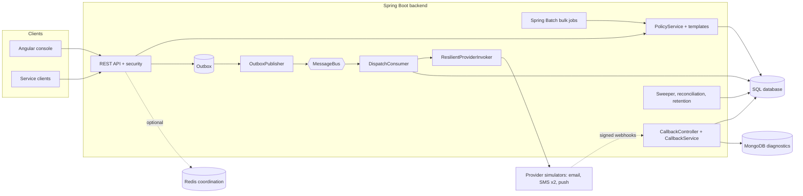

# Digital Messaging and Notification Orchestration Platform (reference implementation)

An **independent reference implementation**, built from a public job description for a senior full-stack engineer on a digital messaging platform (email, SMS, push). It is **not** any employer's internal system and reproduces no proprietary design. Everything is synthetic: data, recipients, providers (simulators), and credentials (dummy values for local use only). No real provider, bank, broker or customer is involved.

It demonstrates, in one runnable repository: a Spring Boot 3.5 / Java 21 backend (REST API, transactional outbox, message bus, dispatch pipeline with retries, dead letters and reconciliation, signed provider callbacks, Spring Batch bulk jobs), an Angular 20 operations console and an equivalent React 19 console (same backend contract), SQL migrations (PostgreSQL-compatible, Oracle mapping documented), MongoDB diagnostics archive, observability and deployment assets, ADRs, runbooks and an AI-assisted engineering workspace.

## Status at a glance

Honest status. Numbers (test counts, pass/fail, coverage, timings) live **only** in [`docs/validation/VALIDATION_REPORT.md`](docs/validation/VALIDATION_REPORT.md); this README does not repeat them. If that file is missing or older than the code, treat the corresponding row as unverified.

| Area | Status | Notes |
|---|---|---|
| Backend build and unit/integration tests (H2, in-memory bus, in-memory Mongo) | Executed on the authoring machine; results in the validation report | profile `test`, no Docker needed |
| Angular unit tests and production build | Executed on the authoring machine; results in the validation report | Karma/Jasmine, headless Chrome |
| Local end-to-end run (backend profile `local` + scripts) | Executed where recorded in the validation report | API on port 18080 |
| Failure-recovery scripts (`tests/failure-recovery`) | Need a running backend; executed only if recorded in the validation report | black-box counterparts of `FailureRecoveryIT` |
| Static analysis (SpotBugs, Checkstyle) and dependency scan | Profiles configured; execution status per the validation report | dependency scan is skipped without an NVD key |
| Testcontainers suites (`*ContainerIT`) | **NOT executed** (no Docker) | compile only under `-Pcontainers` |
| RabbitMQ, Redis, real MongoDB, real PostgreSQL, Oracle | **NOT executed** | adapters and DDL exist; only pure parts (topology vs `definitions.json`) are tested |
| Docker build, Docker Compose, Kubernetes, Helm, Cloud Foundry | **NOT executed** | statically validated by `scripts/validate-infra.sh` and `cloud-foundry/validate-manifest.mjs` |
| k6 load tests | **NOT executed** | the Node load driver can run locally |
| GitHub Actions / Jenkins / Bamboo pipelines | **NOT executed** | definitions only |
| Prometheus rules, Grafana dashboards, OpenTelemetry collector | **NOT executed** | files reviewed, not loaded into running systems |
| Spec 0001 (priority aging) | **Not implemented** | worked specification example; see ADR-0013 |

Traceability from job-description requirements to code, tests and limitations: [`docs/traceability/job-description-traceability-matrix.md`](docs/traceability/job-description-traceability-matrix.md) (CSV copy next to it).

## Architecture at a glance

Key behaviours: at-least-once transport plus idempotent consumer gives effectively-once business processing (never claimed across the provider boundary); an ambiguous email/SMS outcome becomes `DELIVERY_UNKNOWN` and is reconciled before any resend; policy rejections are persisted `REJECTED` messages answered `202`; a replayed callback is answered `200`. Details: `docs/architecture/`, `docs/design/DEVIATIONS.md` (what was actually built; it wins over `docs/design/CONTRACT.md`).

## Repository map

| Path | Content |
|---|---|
| `backend/` | Spring Boot 3.5 / Java 21 service (`src/main/java/com/example/messaging/...`), Flyway migrations, OpenAPI contract, tests |
| `frontend-react/messaging-console-react/` | React 19 + TypeScript + Vite console, same pages and API contract as the Angular one (see its README); live-checked in `docs/validation/react-frontend.md` |
| `frontend/messaging-console/` | Angular 20 console (standalone components, signals); `frontend/mock-api/` is an opt-in UI stub |
| `docs/` | `adr/`, `architecture/`, `database/`, `security/`, `operations/` (+ `runbooks/`), `leadership/`, `interview/`, `design/`, `traceability/`, `validation/`, `api/`, `pdf/`; start at [`docs/index.md`](docs/index.md) |
| `specs/` | Spec-driven development examples (0001 not implemented, 0002 implemented as a simulator) |
| `ai-engineering/`, `.github/`, `AGENTS.md` | AI-assisted engineering workspace (see below) |
| `infrastructure/` | Docker, Compose, Kubernetes (kustomize), Helm, RabbitMQ, PostgreSQL, Mongo init (all NOT executed) |
| `cloud-foundry/` | manifests, vars, deploy/blue-green/rollback/smoke scripts (NOT executed) |
| `observability/` | Prometheus rules, Grafana dashboards, OpenTelemetry collector config |
| `tests/` | `failure-recovery/` scripts, `end-to-end/` (see Tests) |
| `performance/` | k6 scripts (NOT executed) and Node load driver |
| `scripts/` | `run-local.sh`, `stop-local.sh`, `mvn.sh`, `it.sh`, `seed-demo.sh`, `smoke-test.sh`, `generate-dataset.sh`, `validate-infra.sh`, `make-zip.py` |
| `tools/pdf/` | Node/pdfkit PDF renderer used for the documentation PDFs |
| `Jenkinsfile`, `bamboo-specs/`, `.github/workflows/` | CI/CD definitions (NOT executed) |

## Technology choices (ADRs)

| Concern | Choice | ADR |
|---|---|---|
| Async transport | RabbitMQ behind a `MessageBus` port (in-memory adapter locally); Kafka documented as the alternative | [0001](docs/adr/0001-asynchronous-messaging-rabbitmq-vs-kafka.md) |
| Providers | Adapter per channel + data-driven selection | [0002](docs/adr/0002-provider-abstraction.md) |
| Lifecycle | Explicit state machine with CAS ownership | [0003](docs/adr/0003-message-lifecycle-state-machine.md) |
| Idempotency | Four layers (API key, consumer, callback event, provider reference) | [0004](docs/adr/0004-idempotency.md) |
| Database | PostgreSQL primary (H2 in PostgreSQL mode locally), Oracle-mappable SQL, Mongo only for diagnostics | [0005](docs/adr/0005-database-postgresql-vs-mysql-oracle-and-nosql.md) |
| Retries and DLQ | Exponential backoff with jitter, poison threshold, operator replay | [0006](docs/adr/0006-retry-and-dead-letter-policy.md) |
| Templates | Versioned, version pinned at accept time | [0007](docs/adr/0007-template-versioning-and-pinning.md) |
| Platform | Cloud Foundry and Kubernetes manifests, neither executed | [0008](docs/adr/0008-cloud-foundry-vs-kubernetes.md) |
| Outbox | Same-transaction outbox, CAS-claiming publisher | [0009](docs/adr/0009-outbox-pattern.md) |
| Ambiguity | `DELIVERY_UNKNOWN` + reconciliation | [0010](docs/adr/0010-ambiguous-outcome-and-reconciliation.md) |
| Tenancy and authz | JWT tenant claim, 404 on foreign resources | [0011](docs/adr/0011-multi-tenancy-and-authorization.md) |
| Consent and suppression | Ordered policy, tenant-scoped suppression | [0012](docs/adr/0012-consent-and-suppression-policy.md) |
| Priority aging | Proposed only, not implemented | [0013](docs/adr/0013-priority-aging.md) |

## Quick start (local, no Docker)

Prerequisites: JDK 21, Maven (or the project wrapper script), Node 24 / npm. On the authoring machine JDK 21 and Maven are resolved by full path inside `scripts/mvn.sh` and `scripts/run-local.sh`; adjust those two files on another machine. Port 8080 was occupied on the authoring machine, so the API uses **18080** and the Angular dev server **14200**.

1. Build the backend jar: `bash scripts/mvn.sh -DskipTests package` (or `bash scripts/mvn.sh clean verify` to build and test).
2. Start it with profile `local`: `bash scripts/run-local.sh` (H2, in-memory bus, in-memory Mongo, simulators, dev token endpoint). Extra Spring arguments pass through, e.g. `bash scripts/run-local.sh --messaging.dispatch.backoff-base-ms=100`. The application has **no default profile on purpose**; without `local` or `test` there is no dev token issuer.
3. Optional demo data and checks: `bash scripts/seed-demo.sh` and `bash scripts/smoke-test.sh` (both call the API through Node scripts in `scripts/lib/`).
4. Start the console: in `frontend/messaging-console` run `npm ci` once, then `npm start` (Angular dev server on **14200** with `proxy.conf.json` forwarding `/api`, `/dev` and `/actuator` to `http://localhost:18080`).
5. Sign in on the login page by picking a persona (dev tokens from `POST /dev/token`): Platform admin, Tenant admin (retail), Sender (retail), Operator, Template author, Template approver, Auditor. The Sender persona carries the `messages:bulk` scope. Without a backend, `npm run start:mock` starts a UI-only stub on 18080.
6. API documentation: Swagger UI at `http://localhost:18080/swagger-ui.html`, OpenAPI JSON at `http://localhost:18080/v3/api-docs`; the committed contract is `docs/api/openapi.yaml`.
7. Scripted API walk-through without curl: `node tests/end-to-end/e2e.mjs` (see the header of the script for the base URL). That script is being added by a separate work stream and was **not present** when this README was written; until it exists use `bash scripts/smoke-test.sh` and `bash scripts/seed-demo.sh`. Stop the backend with `bash scripts/stop-local.sh` if it was started in the background, otherwise Ctrl+C.

Dummy secrets (for example `local-dev-secret-not-for-production`) exist only in `application-local.yml` / `application-test.yml`; `prod-like` reads secrets from environment variables. Never commit a real `.env`; copy `.env.example` and keep the copy out of version control.

## Tests: commands for every category

All backend commands run from the repository root through `scripts/mvn.sh` (pinned JDK 21 and Maven, no global exports). Unit tests (`*Test`) run in Surefire, integration tests (`*IT`) in Failsafe. `-Dtest=` selects Surefire classes; `bash scripts/it.sh <ITClass[,ITClass]>` is the fast loop for Failsafe classes. Nothing below is claimed to pass here: see the validation report.

| Category | Command | Main classes |
|---|---|---|
| Everything (unit + integration + JaCoCo gate) | `bash scripts/mvn.sh clean verify` | all |
| Unit | `bash scripts/mvn.sh test` | `MessageStateMachineTest`, `RetryPolicyTest`, `PolicyServiceTest`, `TemplateRendererTest`, `RowProcessorTest` |
| Integration | `bash scripts/mvn.sh verify` | `MessageLifecycleIT`, `DispatchFlowIT`, `TemplateLifecycleIT` |
| API / contract | `bash scripts/it.sh NotificationApiIT,PreferenceApiIT,ProviderApiIT,BulkJobApiIT,OpenApiContractIT` | those classes |
| DB (migrations, query shape) | `bash scripts/it.sh RepositoryQueryCountIT,MessageLifecycleIT` | Flyway runs at context start |
| Queue / bus | `bash scripts/mvn.sh test -Dtest=InMemoryMessageBusTest,RabbitBusSupportTest,RabbitTopologyTest,GracefulShutdownTest` and `bash scripts/it.sh BackpressureIT` | |
| Provider | `bash scripts/mvn.sh test -Dtest=SimulatedProviderTest,ProviderRegistryTest,ResilientProviderInvokerTest,FaultInjectorTest,NewProviderWithoutOrchestrationChangeTest` and `bash scripts/it.sh ProviderOutcomeIT,ChannelDispatchIT` | |
| Callback | `bash scripts/mvn.sh test -Dtest=SignatureVerifierTest,ReplayGuardTest,EventNormalizerTest` and `bash scripts/it.sh CallbackApiIT` | |
| Idempotency | `bash scripts/mvn.sh test -Dtest=IdempotencyServiceTest` and `bash scripts/it.sh IdempotentConsumerIT` | |
| Concurrency | `bash scripts/it.sh ConcurrencyIT,CancelRaceIT` | |
| Security | `bash scripts/it.sh SecurityIT,TenantIsolationIT,DevTokenDisabledIT` and `bash scripts/mvn.sh test -Dtest=SecurityMatrixTest,JwtAuthConverterTest,RedactionTest` | |
| Batch | `bash scripts/it.sh BulkJobBatchIT,BulkJobApiIT,FailureRecoveryBulkIT,BulkJobRestartConcurrentIT` and `bash scripts/mvn.sh test -Dtest=CsvRulesTest,TokenBucketRateLimiterTest,BulkJobStoreTest` | |
| Failure scenarios (in-JVM) | `bash scripts/it.sh FailureRecoveryIT,ReconciliationIT,ReplayServiceIT` | scenarios 01-10 |
| React unit | `npm test -- --run` in `frontend-react/messaging-console-react` (Vitest + Testing Library + MSW); lint `npm run lint`, typecheck `npm run typecheck`, build `npm run build`; live UI check `node tests/end-to-end/react-ui-check.mjs` | `*.test.tsx` |
| Angular unit | `npm test` in `frontend/messaging-console` (Karma, ChromeHeadless); lint: `npm run lint`; build: `npm run build` | `*.spec.ts` |
| End-to-end (API, needs a running `local` backend) | `node tests/end-to-end/e2e.mjs` (not present at the time of writing; fallback `bash scripts/smoke-test.sh`) | see script header |
| UI smoke (optional Playwright, NOT executed) | described in `tests/end-to-end/ui-smoke.md` | |
| Failure-recovery scripts (need a running `local` backend) | `node tests/failure-recovery/provider-outage.mjs`, `node tests/failure-recovery/callback-replay.mjs`, `node tests/failure-recovery/provider-timeout.mjs` | see `tests/failure-recovery/README.md` |
| Performance (local) | `node performance/node-load/load-driver.mjs --scenario submit --concurrency 16 --duration 30` | see `performance/README.md` |
| Performance (k6, NOT executed) | `k6 run -e BASE_URL=http://localhost:18080 performance/k6/submit-high-volume.js` and the other scripts in `performance/k6/` | |
| Containers profile (Testcontainers, NOT executed) | `bash scripts/mvn.sh verify -Pcontainers` (needs Docker) | `RabbitMessageBusContainerIT` |
| Static analysis | `bash scripts/mvn.sh -Pstatic-analysis -DskipTests verify` (SpotBugs + Checkstyle) | `backend/config/` |
| Security / dependency scan | set `NVD_API_KEY` in your environment (never in files), then `bash scripts/mvn.sh -Psecurity-scan -DskipTests verify`; without a key the scan is skipped by profile `no-nvd-key` | OWASP dependency-check |
| Infrastructure static validation | `bash scripts/validate-infra.sh` (reports PASS / FAIL / SKIPPED per check) | |

## Containers, Kubernetes, Helm, Cloud Foundry (NOT executed here)

These commands are documented in `docs/operations/deployment/README.md`, `docs/operations/kubernetes-guide.md` and `docs/operations/cloud-foundry-guide.md`. They were **not run** (no Docker host, no cluster, no Cloud Foundry foundation); treat them as untested until you run them.

- Docker Compose: `docker compose --env-file .env -f infrastructure/compose/docker-compose.yml up -d --build` (profile `load` adds k6).
- Kubernetes: kustomize overlays under `infrastructure/kubernetes/overlays/` (for example `kubectl apply -k infrastructure/kubernetes/overlays/dev`).
- Helm: chart in `infrastructure/helm/messaging-platform` with `values.yaml` and `values-prod-like.yaml`.
- Cloud Foundry: `cloud-foundry/scripts/deploy.sh <dev|test>`, `blue-green.sh`, `rollback.sh`, `smoke.sh` after `cf login`; build the artifact with `bash scripts/mvn.sh -Pcloud package`.

## Documentation, PDFs and ZIP

- Documentation map: [`docs/index.md`](docs/index.md). Requirements, scope and assumptions: [`docs/design/requirements-and-assumptions.md`](docs/design/requirements-and-assumptions.md). Documentation consistency fixes: [`docs/design/CONSISTENCY_LOG.md`](docs/design/CONSISTENCY_LOG.md).
- PDFs are generated into `docs/pdf/*.pdf` by the renderer in `tools/pdf/`; if that folder is empty on your checkout, the PDFs have not been built yet.
- The distributable archive is `Schwab_Digital_Messaging_Platform.zip` at the repository root, built by `python -I scripts/make-zip.py` (it excludes `node_modules`, `target`, build output, logs and any real `.env`). It exists only after that script has been run.
- Interview preparation material: `docs/interview/`. It is study material, not evidence of production experience.

## AI-assisted engineering workspace

`AGENTS.md`, `.github/copilot-instructions.md`, `.github/instructions/`, `.github/prompts/` and `ai-engineering/` (guide: [`ai-engineering/README.md`](ai-engineering/README.md)) describe how AI assistants are given context (architecture, API, lifecycle, security rules), how specs drive work (`specs/`), review checklists and AI code-review exercises. The code here was written with Claude Code under the written contract in `docs/design/CONTRACT.md`, with deviations logged in `docs/design/DEVIATIONS.md`. The Copilot files are configuration examples; this repository does not claim they were exercised in an IDE.

## Security notice

- All data is synthetic (`example.test` addresses, fictitious recipients). Do not load real customer data.
- All secrets in the repository are dummy values for local use. Production must use a secret store; see `docs/security/secrets-management.md`.
- The dev token issuer (`POST /dev/token`) and fault-injection endpoints exist only under profiles `local` and `test`.
- Callbacks are authenticated by HMAC signature, not by network position. The security analyses in `docs/security/` are self-assessments, not an external audit or penetration test.
- Do not paste real tokens, keys or personal data into issues, logs or documents.

## Known limitations

- Reference implementation: simulators only, no real provider integration, no real identity provider.
- Single-node assumptions for bulk-job stop/restart and parts of the pipeline; multi-node behaviour is reasoned in documentation, not tested.
- Oracle DDL is a static mapping (not executed, and without the V200 bulk ledger). PostgreSQL, RabbitMQ, Redis and MongoDB adapters were not run against real servers.
- No production traffic informed any threshold, SLO or capacity number; performance scripts were not run under k6.
- Message history in the Angular console needs a model mapping change documented in `docs/design/DEVIATIONS.md`.
- Priority aging (spec 0001 / ADR-0013) is not implemented.
- Documents under `docs/leadership/` and the traceability matrix describe how work would be organised; they are not records of a real team or incident.

## React console (added after the initial build)
A React 19 / TypeScript / Vite console lives in `frontend-react/messaging-console-react` and talks to the same backend with the same personas, error mapping and role-aware navigation as the Angular app. Start it with `bash scripts/serve-react.sh 15200 18080` (production build behind an API proxy) or `MODE=dev bash scripts/serve-react.sh 15200 18080`. Verified: lint and typecheck clean, 202 of 202 unit tests, and a headless-Chrome run against the real backend with 0 console errors (`docs/validation/react-frontend.md`). The two PDFs describe the Angular console only.
# Schwab_Digital_Messaging_Platform
