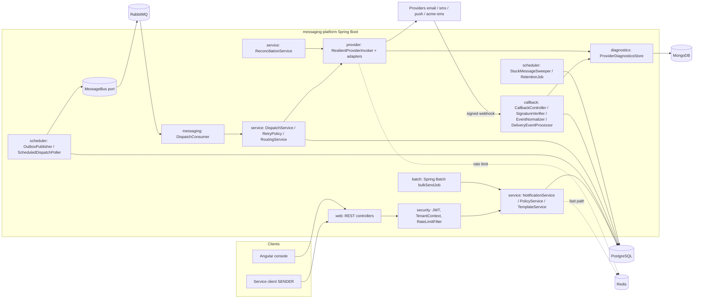

# Architecture Overview

Independent reference implementation of an enterprise omnichannel messaging and notification orchestration platform (EMAIL, SMS, PUSH). All data is synthetic; no real provider is called; simulators stand in for vendors. Binding detail: `docs/design/CONTRACT.md`.

## Goals and non-goals
| Goals | Non-goals |
|---|---|
| Accept messages fast (202) and never lose an accepted message | Real vendor integrations |
| Honest lifecycle: accepted vs sent-to-provider vs delivered vs unknown | Exactly-once across the provider boundary (impossible) |
| Policy enforcement (consent, suppression, quiet hours) at accept and dispatch | Marketing campaign authoring UI |
| Operable: metrics, runbooks, replay, reconciliation | Claim of production compliance (see `docs/security/prod-vs-reference.md`) |
| Provider-agnostic, tenant-isolated | Multi-region active/active |

## Logical architecture

## Key design properties
1. **Persist first, publish after** (ADR-0009): the DB is the source of truth; the broker is a delivery mechanism.
2. **At-least-once transport, idempotent processing** (ADR-0004): effectively-once business effect.
3. **Explicit state machine with CAS ownership** (ADR-0003).
4. **No content or PII on the bus**: `DispatchEnvelope` carries ids only. Variables are stored, rendered body is not; rendering happens at dispatch with the pinned template version (ADR-0007).
5. **Ambiguity is a state** (ADR-0010): `DELIVERY_UNKNOWN` plus reconciliation.
6. **Bounded everything**: consumer concurrency, prefetch, queue depth backpressure, request size, rate limits, bulk concurrency, retries.
7. **Redis and Mongo are optional-degradation dependencies**: `ResilientCoordination` falls back; diagnostics are best-effort.
8. **Ports and adapters** for bus, coordination, providers, diagnostics so local/test run in one JVM.

## Component responsibilities
| Package | Responsibility | Notable classes |
|---|---|---|
| `web` | HTTP, DTOs, error mapping | `GlobalExceptionHandler` |
| `security` | AuthN/Z, tenant, rate limit, body size | `TenantContext`, `AuthorizationService`, `RateLimitFilter`, `RequestSizeFilter` |
| `service` | Use cases and policy | `NotificationService`, `PolicyService`, `DispatchService`, `RetryPolicy`, `ReconciliationService`, `IdempotencyService`, `AuditService` |
| `domain`, `repository` | Entities, state machine, JPA | `MessageStateMachine` |
| `messaging` | Bus port, consumer, DLQ, replay | `MessageBus`, `DispatchConsumer`, `DeadLetterService`, `ReplayService` |
| `provider` | Channel ports, simulators, resilience | `ProviderRegistry`, `ResilientProviderInvoker`, `FaultInjector` |
| `callback` | Webhook auth and normalization | `SignatureVerifier`, `ReplayGuard`, `EventNormalizer` |
| `batch` | Bulk send | `BulkJobConfig`, `RecipientRowProcessor` |
| `scheduler` | Outbox, poller, sweeper, retention | `OutboxPublisher`, `StuckMessageSweeper` |
| `metrics` | All custom meters | `MessagingMetrics` |

## Runtime topology (threads and pools)
- Tomcat request threads (API); bounded by server config.
- `DispatchConsumer` workers: `messaging.dispatch.concurrency` (default 8).
- Provider call executor (time limiter): bounded `ThreadPoolExecutor`; separate from consumer workers to avoid starvation by hanging providers.
- Scheduler threads: outbox, poller, sweeper, retention.
- Batch `TaskExecutor`: `messaging.bulk.concurrency` (default 4).
- HikariCP pool sizing: see `docs/database/transactions-and-connection-pooling.md`.

## Related documents
Flows: `submission-flow.md`, `dispatch-retry-flow.md`, `callback-flow.md`, `reconciliation-flow.md`, `bulk-job-flow.md`, `template-approval-flow.md`. Data: `er-diagram.md`. Ops views: `deployment-views.md`. Semantics: `delivery-semantics.md`. Failure analysis: `reliability-scenarios.md`.
