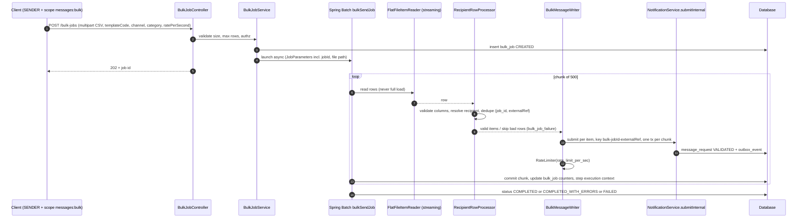

# Bulk Job Flow (Spring Batch)

## Properties
- **Restart safety**: deterministic idempotency keys make re-processing a chunk a no-op; `POST /bulk-jobs/{id}/restart` relaunches the same `JobParameters` and resumes from the last committed chunk.
- **Skip policy**: up to `messaging.bulk.skip-limit` invalid rows skipped and recorded; beyond it the job is `FAILED`. Transient DB errors retried 3 times.
- **Bounded concurrency**: `messaging.bulk.concurrency` (default 4), multi-threaded step only behind `SynchronizedItemStreamReader`.
- **Isolation of priorities**: bulk messages default to LOW/NORMAL priority so they cannot starve CRITICAL/HIGH queues; aging (spec 0001) adds starvation protection for LOW.
- **Throttle**: writer-side rate limit plus the normal provider token bucket; consent policy is applied again at dispatch.
- **Progress**: `messaging.bulk.progress{jobId}` gauge; `GET /api/v1/bulk-jobs/{id}` and `/failures` (paged).
- **Stop**: `POST /bulk-jobs/{id}/stop` marks `STOPPED` and the step ends after the current chunk; `ABANDONED` is set by an operator/sweeper for jobs that never finish (see runbook `bulk-job-stuck.md`).
- Schema: `bulk_job`, `bulk_job_failure`, Spring Batch tables (`V100__spring_batch.sql`).
