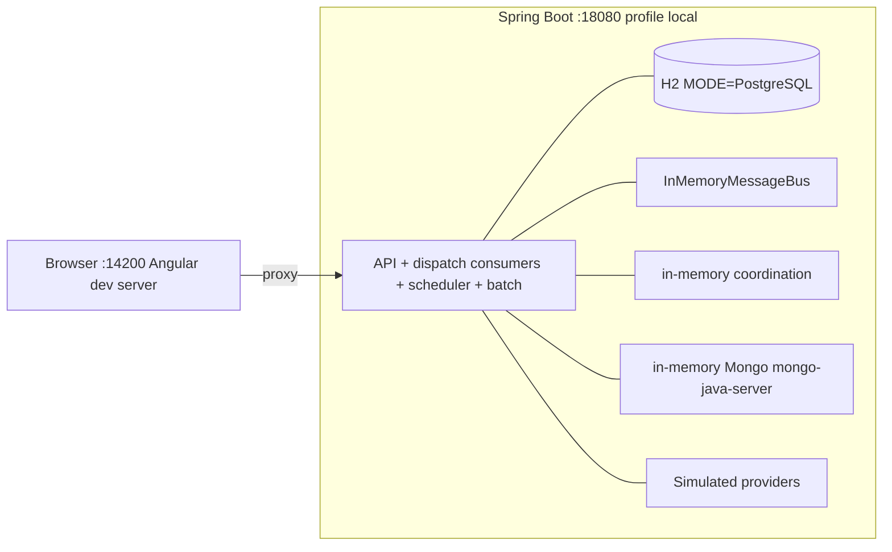
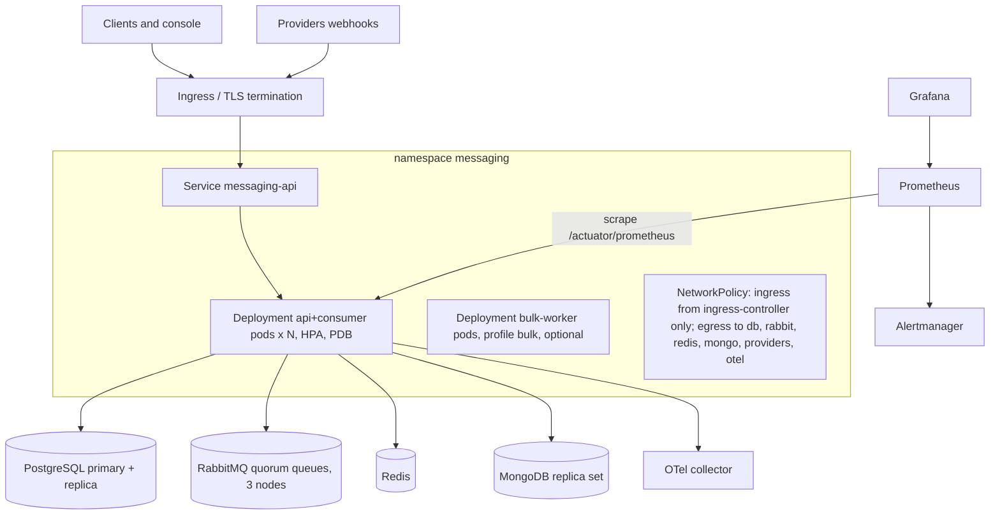
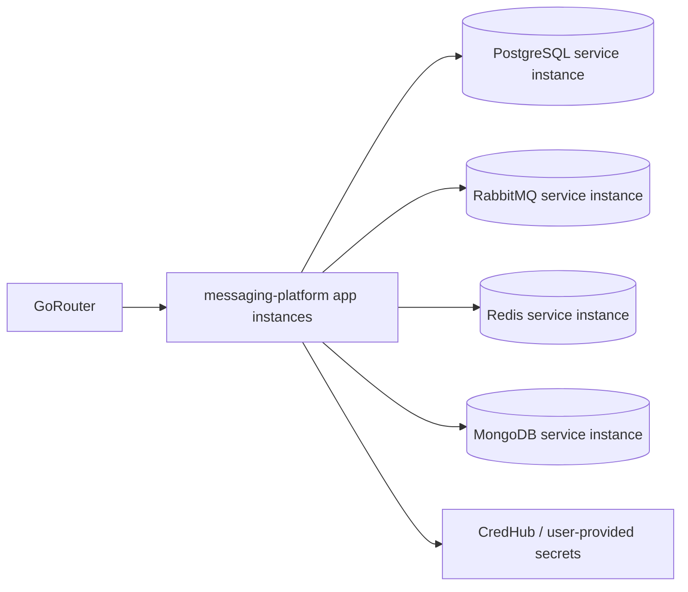

# Deployment Views

**Honesty note**: none of the container, Kubernetes, Helm or Cloud Foundry assets below were executed in the authoring environment (no Docker/kubectl/cf). Only the `local` profile (single JVM, H2, in-memory bus) was run. These diagrams describe intended topology.

## 1. Local (executed): single JVM

## 2. Prod-like on Kubernetes (not executed)

Notes: split API and consumers into separate Deployments if consumer saturation should not affect API latency (profile-controlled consumers: see source `messaging.*` config); scale consumers on queue depth (KEDA or custom metric adapter, an option), API on CPU/RPS. Single replica count assumptions in `infrastructure/helm` values are starting points.

## 3. Cloud Foundry (not executed)

`cloud-foundry/manifest.yml`: health check `http` on `/actuator/health/readiness`, env vars map bound services to `SPRING_DATASOURCE_URL` etc.; rolling deploy via `cf push --strategy rolling` (not executed).

## 4. Network and trust zones
| Zone | Components | Rules |
|---|---|---|
| Public edge | Ingress / GoRouter | TLS, WAF/rate limit (prod-vs-reference gap), only `/api/**`, `/actuator/health/**` exposed; `/actuator/prometheus` internal only |
| App | API/consumer pods | No inbound from data zone; egress allow-list |
| Data | PostgreSQL, Rabbit, Redis, Mongo | Inbound only from app zone; credentials from secret store |
| Provider egress | Providers (simulated here) | Egress via allow-list/proxy; callbacks arrive via edge and are HMAC-verified |

## 5. Environments
| Env | Profile | Notes |
|---|---|---|
| dev laptop | `local` | all in-memory, dev token enabled |
| CI | `test` | deterministic, H2; `-Pcontainers` optional |
| staging/prod | `prod-like` + `rabbit` | PostgreSQL, Redis, Mongo, issuer-uri, no dev endpoints |
