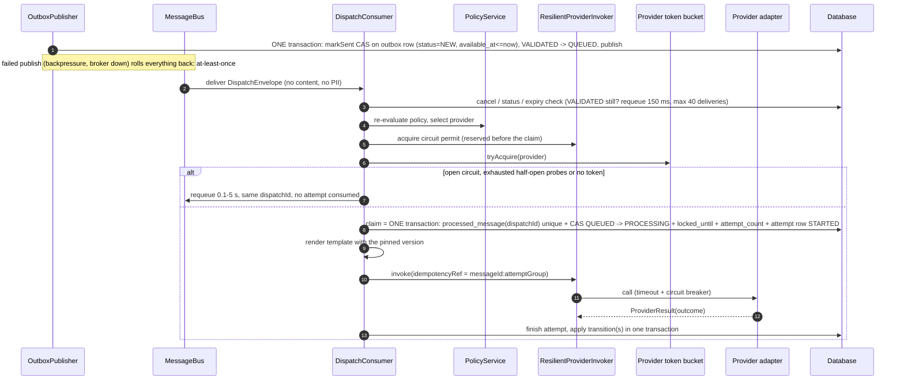
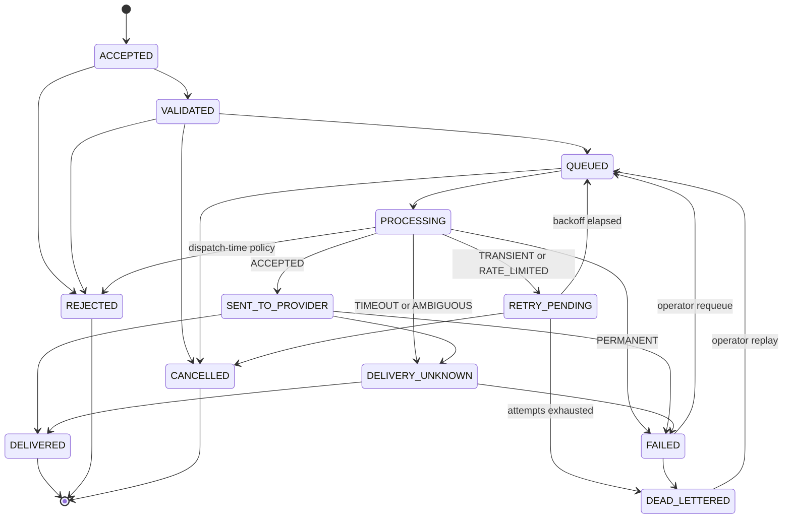

# Dispatch and Retry Flow

> Implemented order (see `docs/design/DEVIATIONS.md`, stage 2 "Behaviour that differs", items 1-6). The first plan checked dedupe and the status CAS first; the code checks cheap refusals first and claims in one transaction.

Notes: quiet hours met at dispatch time defer through a **new outbox row** with `available_at` = end of the window (the message stays QUEUED; there is no QUEUED to VALIDATED transition). Expiry and dispatch-time policy rejection claim first and then move PROCESSING to FAILED(`EXPIRED`) / REJECTED, because the state table has no QUEUED to REJECTED/FAILED. Multi-step outcomes are consecutive, individually legal transitions in one transaction (fallback after PERMANENT_FAILURE: PROCESSING to FAILED to QUEUED; after exhausted retries: PROCESSING to RETRY_PENDING to QUEUED or DEAD_LETTERED). Operator requeue/replay is a CAS FAILED|DEAD_LETTERED to QUEUED plus an outbox event, with a fresh attempt budget (`max_attempts = attempt_count + messaging.dispatch.max-attempts`).

## Outcome mapping

## Retry scheduling
1. `RetryPolicy` computes `next_attempt_at = now + min(cap, base*2^(n-1)) * U(0.5,1.0)`; message becomes `RETRY_PENDING`, counter `messaging.retry.scheduled{channel}`.
2. Re-enqueue is done by bus delayed redelivery (Rabbit TTL+DLX) or, if the bus cannot delay, `ScheduledDispatchPoller` picking `status=RETRY_PENDING AND next_attempt_at <= now`; both end in a CAS `RETRY_PENDING to QUEUED` and a new envelope with a new `dispatchId`.
3. Exhausted attempts: fallback channel if the request allows it and policy approves on that channel; else `DEAD_LETTERED(RETRIES_EXHAUSTED)`.
4. Poison envelope: `DEAD_LETTERED(POISON_MESSAGE)` immediately, with metric `messaging.deadletter.total{reason="POISON_MESSAGE"}`.

## Shutdown
`SmartLifecycle` stops intake, waits up to 30 s for in-flight, unacked deliveries return to the queue; next consumer dedupes via `processed_message`/CAS. A message left PROCESSING by a hard kill is handled by `StuckMessageSweeper` (ADR-0010).

See ADR-0003, ADR-0006, ADR-0010 and `delivery-semantics.md`.
