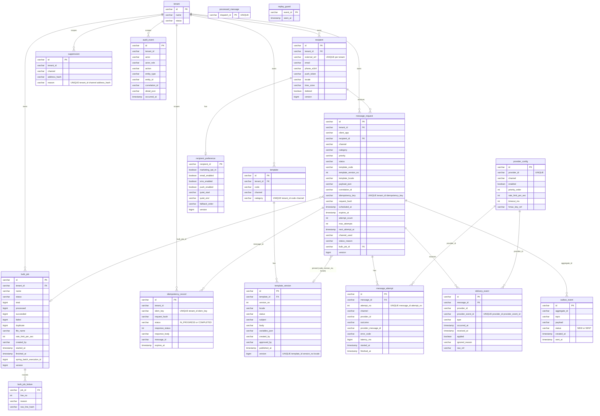

# Entity-Relationship Diagram

Derived from CONTRACT section 4. Column lists show the keys and the columns that matter for relationships and constraints; the migration under `backend/src/main/resources/db/migration` is authoritative (see source). Logical references to `message_request`, `recipient`, etc. are foreign keys; `outbox_event.aggregate_id` and `processed_message.dispatch_id` are logical references only.

Not drawn: Spring Batch metadata tables (`BATCH_JOB_INSTANCE`, `BATCH_JOB_EXECUTION`, `BATCH_STEP_EXECUTION`, ... created by `V100__spring_batch.sql`); `bulk_job.spring_batch_execution_id` references `BATCH_JOB_EXECUTION` logically.

Indexes (CONTRACT 4) are discussed in `docs/database/query-plans-and-indexes.md`.
