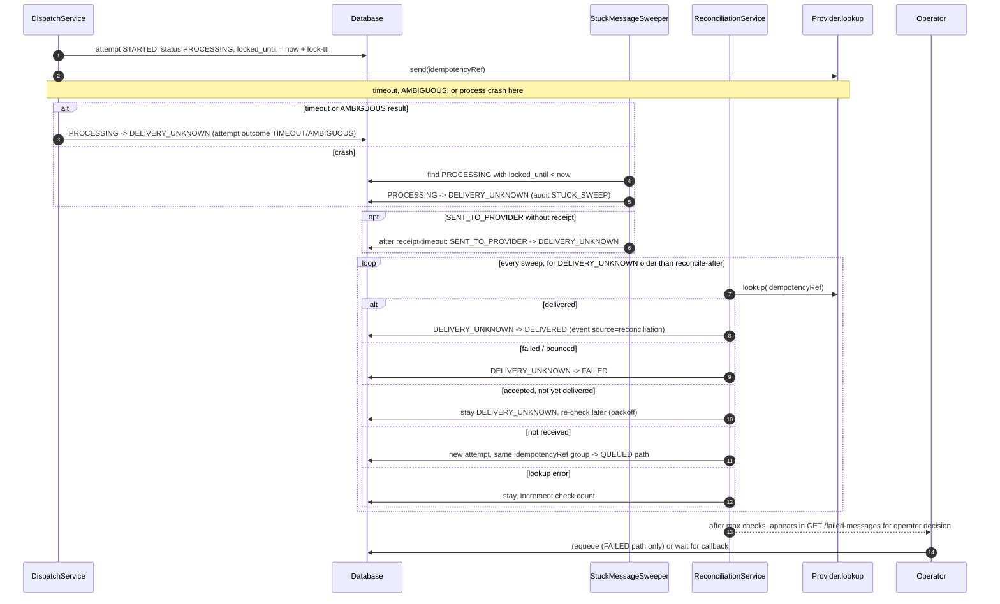

# Ambiguous Outcome Reconciliation Flow

## Decision matrix
| Channel | After TIMEOUT/AMBIGUOUS | Why |
|---|---|---|
| EMAIL | wait for callback, then `lookup`, retry only if "not received" | duplicate emails are visible and reputational |
| SMS | same as EMAIL | duplicate cost and annoyance |
| PUSH | retry allowed (collapse key makes it idempotent) | duplicates collapse on the device |

## Invariants
1. A message in `DELIVERY_UNKNOWN` is never silently retried.
2. Reconciliation never creates DELIVERED without provider-originated evidence (callback or `lookup` result).
3. Late callbacks win over reconciliation (same rank rule); first terminal wins.
4. Every reconciliation action is audited with `lookup` result.

Tests: `FailureRecoveryIT#scenario04_providerTimeout_movesToDeliveryUnknown_reconcilesWithoutDuplicateSend`, `#scenario05_consumerCrashAfterProviderAccept_sweeperMarksDeliveryUnknown`. ADR-0010. Runbook: `docs/operations/runbooks/consumer-crash-ambiguous-outcomes.md`.
