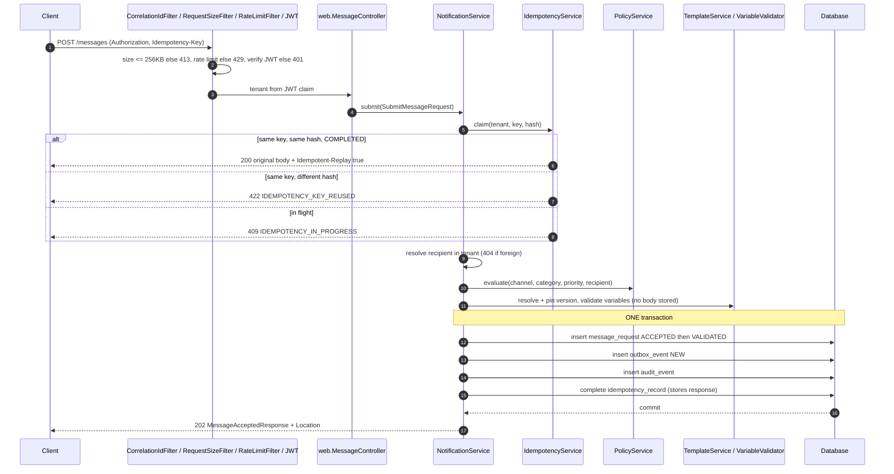

# Submission Flow

`POST /api/v1/messages` (roles SENDER, TENANT_ADMIN, PLATFORM_ADMIN). Returns 202 quickly; no provider call is made on the request thread.

## Notes
- **Backpressure**: before accepting, the API checks queue depth against `messaging.backpressure.max-queue-depth`; if over, 503 `SERVICE_UNAVAILABLE` + `Retry-After`. The idempotency claim is rolled back so the client may retry with the same key.
- **Rejections at accept**: validation failure is 400 `VALIDATION_FAILED`; unknown template 404-class `TEMPLATE_NOT_FOUND`; missing variable `TEMPLATE_VARIABLE_MISSING`; policy rejections (opt-out, suppression, deleted recipient, no address, expiry before a deferred send) are persisted as `REJECTED` and answered **202** with `status=REJECTED` and `statusReason` (`PolicyReason`), not a 4xx; `POLICY_SUPPRESSED` is not returned by the implemented API. Unique-constraint conflicts (duplicate template code+channel or locale version) answer 409 `DUPLICATE_RESOURCE`. A database outage answers 503 `SERVICE_UNAVAILABLE` + `Retry-After: 5`.
- **Scheduled**: `schedule.sendAt` in the future keeps status VALIDATED and defers outbox publication until due; quiet-hours deferral works the same way.
- **State written**: `ACCEPTED` then `VALIDATED` within the same transaction; `QUEUED` is set later by `OutboxPublisher` (ADR-0009).
- **Failure of the transaction** rolls back everything, including the idempotency claim, so a client retry is a clean retry.
- Related: ADR-0004, ADR-0007, ADR-0009, ADR-0012.
