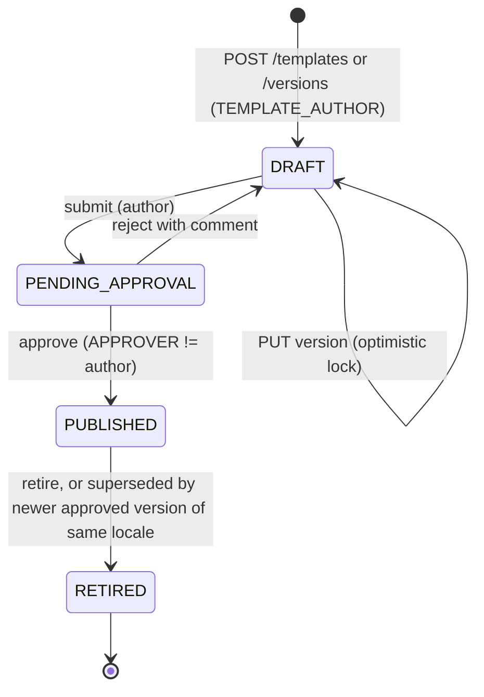
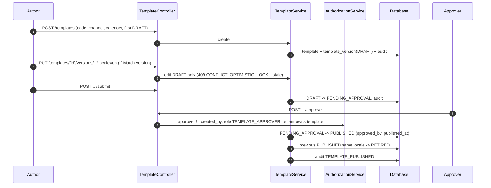

# Template Approval Flow

## Controls
- Preview (`POST /templates/preview`) renders with sample data using the same `TemplateRenderer`, never sends.
- `TemplateRenderer` is an allow-listed `{{var}}` substitution: variables declared in `variables_json`; unknown variable = `TEMPLATE_RENDER_ERROR`; HTML escaping for email HTML; no expression evaluation, no includes, no reflection.
- Category binding: template category is fixed per template so marketing content cannot be sent as TRANSACTIONAL (ADR-0012).
- Published versions are immutable; edits require a new version (ADR-0007).
- Four-eyes: approver and author must differ; enforced server-side.
- Audit trail: `GET /api/v1/templates/{id}/history`.
